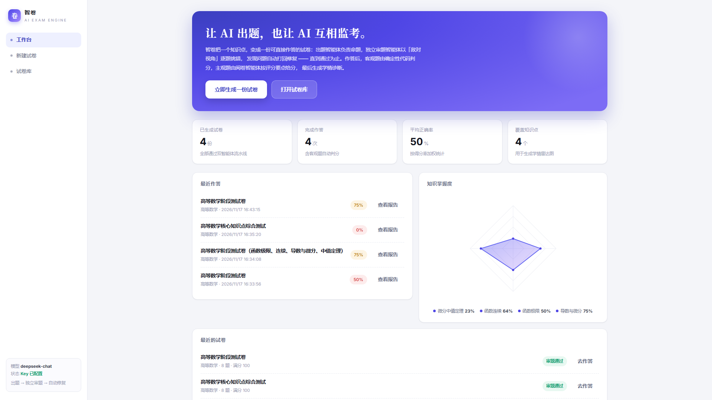
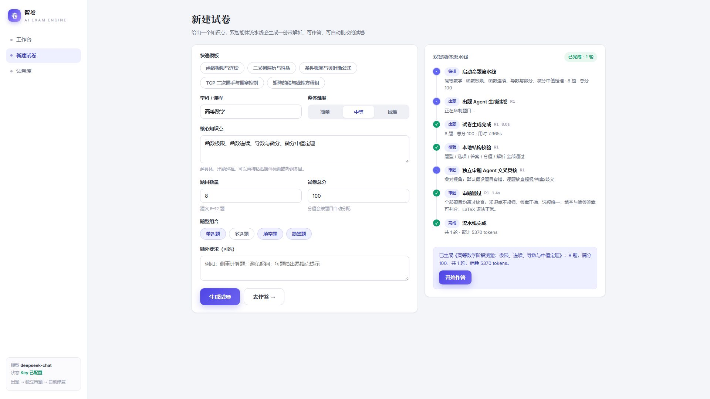
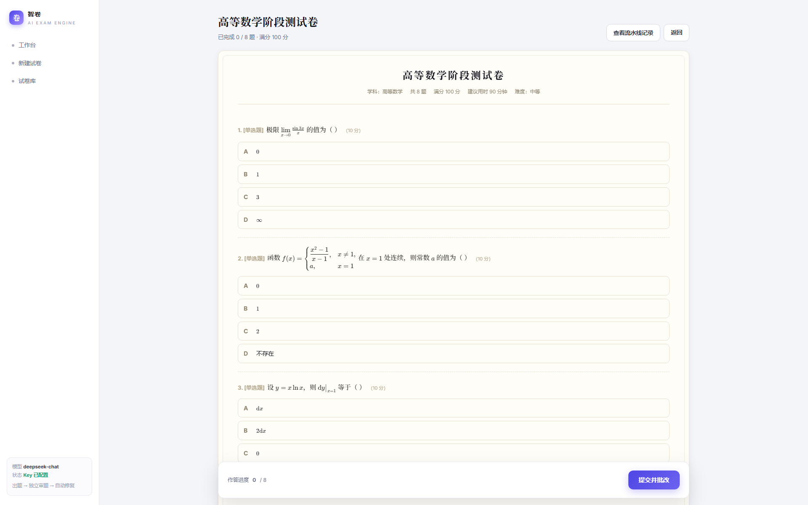
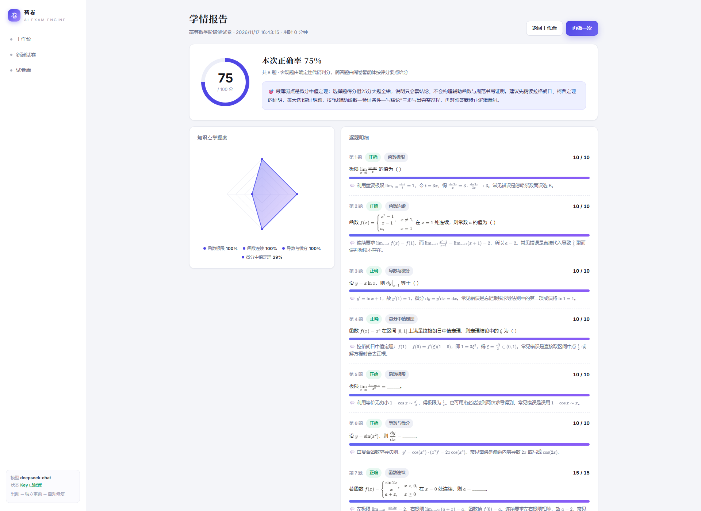

# 智卷 · AI 智能出卷与批改引擎

> 一个知识点 → 一份可作答、可自动批改、可诊断学情的完整试卷。
> 核心主张：**让 AI 出题，也让 AI 互相监考。**

<p align="center">
  
  
  
</p>

---

## 界面预览

**工作台**：指标卡 + 知识点雷达 + 最近作答



**新建试卷**：左侧填需求，右侧实时展示双智能体流水线的每一步（出题 → 本地校验 → 独立审题 → 修复）



**在线作答**：纸感排版 + KaTeX 公式渲染 + 四种题型交互



**学情报告**：得分环 + 知识点雷达 + 逐题反馈 + AI 学情诊断



---

## 一、它解决什么问题

高校教师命题一份合格的试卷，通常需要 1–2 小时：找题、改题、配分、写解析、还要反复检查「有没有超纲」「有没有两个正确答案」「填空答案是否唯一」。
学生做完题后，往往只拿到一个分数，拿不到「你哪一步错了、哪个知识点没掌握」。

**智卷把这个闭环压缩到几十秒**：输入学科与知识点，系统自动生成一份带解析的试卷；作答后，客观题由确定性代码判分，简答题由阅卷智能体按评分要点给分，最后输出知识点掌握度雷达图与学情诊断。

---

## 二、核心创新：双智能体互检流水线

单一模型生成试卷时有一个致命问题：**它会为自己的输出辩护**。同一段上下文里既当出题人又当审题人，审题结果几乎必然是「这份试卷很好」。

智卷的解法是**把生成者与审查者彻底分离**：

```
                  ┌──────────────────────────────┐
                  │           命题需求           │
                  │  学科 / 知识点 / 题数 / 总分  │
                  └──────────────┬───────────────┘
                                 ▼
        ┌────────────────────────────────────────────┐
        │  ① 出题 Agent（独立上下文，temperature 0.85） │
        └───────────────────────┬────────────────────┘
                                ▼
        ┌────────────────────────────────────────────┐
        │  ② 本地结构校验（确定性代码，零成本）         │
        │     题型 / 选项 / 答案 / 分值 / 解析          │
        └───────────────────────┬────────────────────┘
                                ▼
        ┌────────────────────────────────────────────┐
        │  ③ 独立审题 Agent（敌对视角，temperature 0.15）│
        │     逐题核查：超纲 / 答案错误 / 选项缺陷 /     │
        │     歧义 / 不可判分 / 分值错误 / 公式语法      │
        └───────────────────────┬────────────────────┘
                                │
                  ┌─────────────┴─────────────┐
             未通过 │                          │ 通过
                  ▼                          ▼
        ┌────────────────────┐         ┌──────────────┐
        │ ④ 修复 Agent        │         │  交付试卷     │
        │  只改有问题的题      │         └──────────────┘
        └──────────┬─────────┘
                   │  回边（最多 2 轮，带终止条件）
                   └────────► ② 本地结构校验
```

三个工程判断支撑了这套设计：

1. **验证比生成便宜** —— 结构校验是确定性的、几乎零成本；先用它淘汰明显不合法的输出，再花钱让审题 Agent 做语义审查。
2. **审题者必须敌对** —— 提示词明确要求「默认假设这份试卷有问题，找不到问题才允许通过」，以此对抗模型的自洽偏差。
3. **必须有终止条件** —— 反馈环最多 2 轮，超过则交付当前版本并显式标记「待人工复核」，避免无限循环与成本失控。

整个流水线的每一步都会以 **SSE 事件流**实时推送到前端，用户可以看见「现在是谁在工作、它发现了什么、被打回了多少次」。

---

## 三、功能清单

| 模块 | 能力 |
|---|---|
| 智能出卷 | 指定学科、知识点、题数、总分、难度、题型组合；支持快捷模板 |
| 双智能体质检 | 出题 → 本地校验 → 独立审题 → 自动修复，全程可视化 |
| 四种题型 | 单选、多选、填空、简答；题干与选项支持 LaTeX 公式渲染 |
| 在线作答 | 纸感试卷排版，作答进度实时统计 |
| 分层批改 | 客观题确定性判分；多选题漏选给半分；填空题支持多可接受答案；简答题 LLM 按评分要点给分 |
| 学情报告 | 得分环、知识点掌握度雷达图、逐题反馈、完整解析 |
| 试卷库 | 历史试卷沉淀，可回溯每份试卷的生成流水线记录 |

---

## 四、技术架构

```
┌─────────────────────────── 浏览器 ───────────────────────────┐
│  React 18 + TypeScript + React Router + KaTeX（本地公式渲染） │
│              fetch + ReadableStream 解析 SSE                  │
└───────────────────────────────┬──────────────────────────────┘
                                │ HTTP / SSE
┌───────────────────────────────▼──────────────────────────────┐
│                       Express（Node.js）                      │
│  routes → pipeline → prompts → llm → DeepSeek API            │
│           grading  → store   （JSON 文件持久化）              │
└──────────────────────────────────────────────────────────────┘
```

**目录结构**

```
zhijuan/
├── client/                  # 前端
│   ├── index.html
│   └── src/
│       ├── components/      # 流水线轨迹、试卷渲染、知识雷达
│       ├── lib/             # API 客户端、LaTeX 富文本
│       ├── pages/           # 工作台 / 新建试卷 / 试卷库 / 作答 / 报告
│       ├── App.tsx
│       └── styles.css       # 设计系统
├── server/                  # 后端
│   ├── index.js             # HTTP 接口与 SSE
│   ├── pipeline.js          # ★ 双智能体互检流水线
│   ├── prompts.js           # ★ 五个角色的提示词资产
│   ├── paper-schema.js      # 结构校验与归一化
│   ├── grading.js           # 分层批改器
│   ├── llm.js               # DeepSeek 网关（重试 / 超时 / 计量）
│   ├── store.js             # JSON 持久化
│   └── env.js               # 配置与环境变量
├── scripts/dev.mjs          # 一条命令同时启动前后端
├── docs/                    # 技术文档与演示脚本
└── vite.config.ts
```

---

## 五、10 分钟极速复现

### 0. 环境要求

- Node.js **≥ 20.12**（推荐 22 / 24）
- 一个 DeepSeek API Key（[获取地址](https://platform.deepseek.com/api_keys)）

### 1. 克隆并安装（约 2 分钟）

```bash
git clone <你的仓库地址>
cd zhijuan
npm install          # 或 pnpm install
```

### 2. 配置 API Key（约 1 分钟）

```bash
# Windows (PowerShell)
Copy-Item .env.example server/.env
# macOS / Linux
cp .env.example server/.env
```

打开 `server/.env`，把 `DEEPSEEK_API_KEY` 换成你自己的 Key：

```ini
DEEPSEEK_API_KEY=sk-xxxxxxxxxxxxxxxx
DEEPSEEK_BASE_URL=https://api.deepseek.com
DEEPSEEK_MODEL=deepseek-chat
PORT=8787
```

> 💡 **暂时没有 Key？也能先看效果。** 执行 `npm run demo:data` 会载入 6 份已生成的试卷与 2 份作答记录，
> 打开页面即可浏览试卷、学情报告与流水线轨迹；生成新试卷、AI 批改仍需配置 Key。

### 3. 启动（约 15 秒）

```bash
npm run dev
```

- 前端：http://localhost:5173
- 后端：http://localhost:8787

> 也可以分别启动：`npm run dev:server` 与 `npm run dev:client`。

### 4. 验证闭环（约 2 分钟）

1. 打开 http://localhost:5173 ，侧边栏应显示 **「Key 已配置」**。
2. 点击「新建试卷」，选一个快捷模板（如「函数极限与连续」），点「生成试卷」。
3. 右侧实时出现双智能体流水线轨迹：出题 → 校验 → 审题 →（必要时）修复。
4. 生成完成后点「开始作答」，随便作答几题，点「提交并批改」。
5. 查看学情报告：得分环、知识点雷达、逐题反馈。

### 5. 生产模式（可选）

```bash
npm run build
npm start        # 访问 http://localhost:8787
```

### 6. 自动化测试（可选）

```bash
npm test                            # 8 个单元测试：结构校验、分值归位、答案修正
node scripts/smoke.mjs              # 全链路冒烟测试（真实调用模型）
node scripts/check-robustness.mjs   # 多学科回归（数据结构 / 计算机网络 / 概率论）
```

### 常见问题

| 现象 | 原因与解法 |
|---|---|
| 提示「Key 未配置」 | `server/.env` 不存在或变量名为 `DEEPSEEK_API_KEY`；改完需重启服务 |
| 生成很慢 / 超时 | 首次调用未命中模型缓存；接口已内置 3 次重试与 120s 超时 |
| 页面 404 | 开发模式请访问 **5173** 端口，而非 8787 |
| 中文乱码 | 终端编码问题，不影响页面渲染 |

---

## 六、关键设计决策

**1. 不用数据库，用 JSON 文件**
目标是「10 分钟复现」。引入 SQLite / Postgres 会让复现多出安装与迁移成本，而本项目的并发量级完全不需要数据库。数据落在 `server/data/`（已加入 `.gitignore`）。

**2. 客观题绝不交给模型**
能算清楚的地方用代码算：单选/多选/填空全部确定性判分。只有简答题这类「需要理解语义」的题目才调用模型。这既省 token，也把误判概率降到最低。

**3. 自研极简 LaTeX 渲染，不引入 Markdown 全家桶**
题目文本只需要「公式 + 加粗 + 换行」三种能力。自己实现 60 行代码，比引入 `react-markdown + remark-math + rehype-katex` 三个依赖更可控。

**4. 雷达图用纯 SVG**
少一个图表库依赖，就少一个复现失败点。

**5. 前端直连自己的后端，不暴露 Key**
API Key 只存在于服务端环境变量，前端任何请求都不携带密钥。

---

## 七、API 一览

| 方法 | 路径 | 说明 |
|---|---|---|
| GET | `/api/health` | 服务状态、模型信息、Key 是否配置 |
| POST | `/api/papers/generate` | **SSE** 生成试卷，逐步推送流水线事件 |
| GET | `/api/papers` | 试卷列表 |
| GET | `/api/papers/:id` | 试卷详情（含流水线记录） |
| DELETE | `/api/papers/:id` | 删除试卷 |
| POST | `/api/attempts` | 提交作答并批改 |
| GET | `/api/attempts` | 作答记录列表 |
| GET | `/api/attempts/:id` | 作答详情（含批改结果与诊断） |
| GET | `/api/overview` | 学情总览 |

---

## 八、已知限制与后续规划

**当前限制**

- 简答题批改依赖模型判断，对「部分正确」的边界题可能存在 ±1 分的波动。
- 流水线最大修复 2 轮，极个别情况下仍可能交付「待人工复核」的试卷。
- JSON 文件存储不适合多用户并发，当前定位是单机 / 演示环境。

**后续规划**

- 引入向量检索，支持按课程大纲与历史错题定向出题
- 题库沉淀与题目去重（避免同一知识点反复出同一道题）
- 教师端：手动编辑题目、调整分值、导出 PDF 试卷
- 多人班级维度：班级知识点热力图

---

## 九、AI 协作说明

本项目的**全部代码、文档与 Prompt 均在 AI 编程助手（DeepSeek Harness Agent）协作下完成**，完整保留了开发过程的三类证据：

| 证据 | 位置 | 说明 |
|---|---|---|
| 细粒度提交历史 | `git log` | 每次提交对应一个可独立解释的功能落地，禁止一次性提交全部代码 |
| AI 协作记录（整理版） | `docs/AI协作记录.md` | 6 个核心迭代的 Prompt 链：意图 → AI 方案 → 决策依据 → 验证结果，含 3 次真实 Bug 定位与修复 |
| 会话完整记录（原始导出） | `docs/ai-history/` | 由 `scripts/export-ai-history.mjs` 从会话日志自动导出，保留 7 轮人类 Prompt 与 200+ 次工具调用的完整轨迹，密钥已自动打码 |

AI 在其中承担实现，人类负责**意图定义、方案取舍与结果验收** —— 这正是 Vibe Coding 的核心：代码编写成本趋近于零，定义问题与判断质量的能力成为关键。

---

## 十、许可证

MIT License
